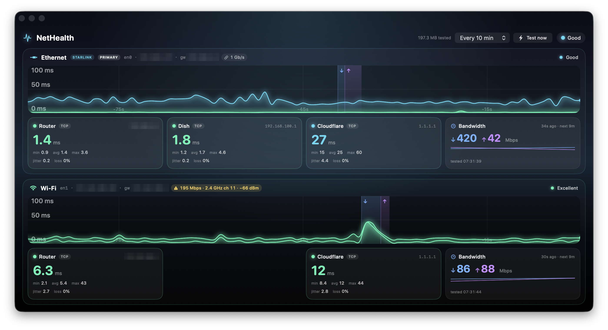

# NetHealth

**A native macOS monitor for every network connection your Mac has, all at once.**

Got Ethernet to one ISP and Wi-Fi to another? NetHealth gives each link its own stacked panel. You see live latency to that link's router, to the internet, and (on Starlink) to the dish, drawn as smoothly scrolling **aurora ribbons**. Each link also gets a periodic **download/upload test** and a readout of the **local link rate**, so it's obvious which connection is struggling and whether the problem is your ISP or your own Wi-Fi.



**Docs:** [Architecture diagrams](https://pcwilliams.github.io/nethealth/architecture.html) · [Build tutorial](https://pcwilliams.github.io/nethealth/tutorial.html)

## Why

macOS sends ordinary traffic over one "primary" connection, so most tools only ever measure that one. NetHealth pins each probe and speed test to a specific interface, so a second link is measured as itself, not through the first.

It earned its keep quickly. A 5 Gb/s fibre line kept testing at ~140 Mbps over Wi-Fi. The link-rate chip showed why: the Mac had joined the router's **2.4 GHz** band at 137 Mbps. The fibre was fine; the Wi-Fi band was the bottleneck. (It later moved to 5 GHz, but on a 20 MHz channel with a weaker signal the rate stayed at 137 Mbps: the chip shows that too.)

## Features

### Every connection, side by side
- **One panel per link.** Each interface with its own default route (Wi-Fi, Ethernet, …) gets a panel, badged `PRIMARY` for the link macOS is using and `STARLINK` when a Starlink dish answers behind it. Panels appear and disappear as links come and go.
- **Interface-pinned probes.** Every socket is bound to its link (`IP_BOUND_IF` / `requiredInterface`), so each panel measures that link's real latency.
- **Aligned cards.** Router · Dish · Cloudflare · Bandwidth sit in fixed slots so stacked panels line up, with a gap where a link has no dish.

### Latency
- **Probed once a second:** each link's own router, Cloudflare `1.1.1.1`, and the Starlink dish where present.
- **Per-target stats:** current, min / avg / max, jitter and packet loss, plus a badge showing whether the reading came from `ICMP` or the `TCP` fallback.
- **Health colours:** green → amber → red as latency rises, with an ambient background that warms when things degrade.

### Bandwidth
- **Periodic speed test** against Cloudflare's speed endpoints, six parallel streams, download then upload, one link at a time. It runs ~5 s after launch and then every 10 minutes by default (or 1 / 5 / 15 min / hourly / off, or **Test now**).
- **Shows the timestamp** of each test, the live Mbps while it runs, and a sparkline of recent results.
- **Latency under load.** Test periods are shaded on the graph (↓ blue, ↑ violet), so you can see how far latency climbs while the link is saturated (bufferbloat).
- **Easy on data:** each test stops at 3 s or 40 MB ↓ / 15 MB ↑, whichever comes first. A header counter shows what this session has used.
- **Polite:** on HTTP 429 a link backs off (5 → 30 min) and keeps showing its last good reading.

### Local link rate
- **What your own hop can carry**, read from the OS with no traffic sent: Wi-Fi transmit rate, band, channel and signal (`137 Mbps · 2.4 GHz ch 11 · −65 dBm`), or Ethernet speed (`1 Gb/s`).
- **Turns amber** when Wi-Fi is on 2.4 GHz or the last download got close to the link rate. Hover for mode, channel width, noise and SNR.

### The aurora ribbon
- Translucent gradient ribbons with a soft glow, drawn in SwiftUI `Canvas` at 60 fps.
- Positioned by real time, so the graph glides smoothly right-to-left between 1 Hz samples. The Y-axis eases between scales instead of jumping.

### Well-behaved
- **Works on any network.** Routers come from the kernel routing table; the dish is optional and simply omitted where it doesn't exist.
- **Gentle on the Starlink dish.** It gets only a light TCP connect on its web ports, never its gRPC management API (the same endpoint can reboot the unit).
- **Sandboxed.** Latency uses TCP connect time because the App Sandbox blocks ICMP echo replies.

## Requirements

- macOS 14 (Sonoma) or later, Apple Silicon or Intel
- Xcode 16+ to build
- No third-party dependencies

## Build and run

```bash
git clone https://github.com/pcwilliams/nethealth.git
cd nethealth
./run-macos.sh            # build Debug and launch the window
```

Or open `NetHealth.xcodeproj` in Xcode and press ⌘R.

**Signing:** the project is set to the author's development team. To sign with your own, choose your team under *Signing & Capabilities* in Xcode, or run `APPLE_TEAM_ID=XXXXXXXXXX ./run-macos.sh`.

To install a Release build into `/Applications` (falls back to `~/Applications`):

```bash
./deploy.sh
```

## Command-line modes

Every networking path can be checked without the GUI:

```bash
./run-macos.sh Debug --selftest     # each connection × target once, plus the link rate
./run-macos.sh Debug --speedtest    # download + upload over each connection
./run-macos.sh Debug --watch 30     # the GUI's 1 Hz probe loop, one log line per tick
./run-macos.sh Debug --netdiag      # raw socket diagnostics (errno at each step)
```

```
NetHealth self-test — 2 connection(s)
  Ethernet  en0  192.168.1.x    gw 192.168.1.1  (primary)
    link  1 Gb/s
    [OK]   Router      192.168.1.1          0.6 ms  via TCP
    [OK]   Dish        192.168.100.1        1.0 ms  via TCP
    [OK]   Cloudflare  1.1.1.1             34.6 ms  via TCP
  Wi-Fi  en1  192.168.108.x  gw 192.168.108.1
    link  137 Mbps · 5 GHz ch 140 · −74 dBm  802.11ax (Wi-Fi 6)  20 MHz  noise -98 dBm
    [OK]   Router      192.168.108.1        6.1 ms  via TCP
    [--]   Dish        192.168.100.1    not present (optional)
    [OK]   Cloudflare  1.1.1.1             12.2 ms  via TCP
5 targets reachable (4 required across 2 connection(s))
```

```
NetHealth speed test — 2 connection(s), 6 streams, ≤3s / ≤40 MB down, ≤15 MB up
  Ethernet  en0  gw 192.168.1.1  (primary)
    ↓ download     297.9 Mbps     40.3 MB in 1.5s
    ↑ upload        25.3 Mbps      9.4 MB in 3.6s
  Wi-Fi  en1  gw 192.168.108.1
    ↓ download     138.4 Mbps     40.7 MB in 2.6s
    ↑ upload       162.7 Mbps     15.0 MB in 0.8s
4/4 measurements succeeded
```

An absent optional target (the dish, on the non-Starlink link) is reported as `[--] … not present` rather than as a failure. `via TCP` confirms the sandbox is blocking ICMP, as expected.

> **Data usage:** at most ~55 MB per link per test. At the default of every 10 minutes that's up to ~330 MB an hour per connection on a fast link. Choose a longer interval on a metered plan.

## How it works

| Component | Role |
|-----------|------|
| `Gateway` | Reads every per-interface default route from the kernel routing table (`sysctl(NET_RT_DUMP)`) |
| `ConnectionDiscovery` / `NetworkConnection` | Merges routes with `NWPathMonitor` interface types into one live object per link: targets, health, bandwidth results |
| `NetHealthViewModel` | `@MainActor`; the 1 Hz probe loop over every connection × target, and the speed-test scheduler |
| `PingService`, `TCPPinger`, `ICMPPinger` | Interface-pinned latency probes; ICMP first, falling back to TCP connect time |
| `SpeedTester` | Multi-stream HTTPS download/upload over `NWConnection` with `requiredInterface` (URLSession can't pin an interface) |
| `LinkReader` | Wi-Fi rate/band/signal via CoreWLAN; Ethernet speed via `if_data` |
| `AuroraGraphView` | `Canvas` + `TimelineView` time-scrolling ribbons with shaded test windows |
| `ConnectionPanel`, `StatCard`, `BandwidthCard` | The stacked per-link panels and their readouts |

The [architecture page](https://pcwilliams.github.io/nethealth/architecture.html) has interactive diagrams. The [tutorial](https://pcwilliams.github.io/nethealth/tutorial.html) tells how the app was built, prompt by prompt, including the dead ends. `CLAUDE.md` is the developer reference: every design decision, API quirk and lesson learned.

## App icon

Generated in code, modelled on the app's own aurora ribbons:

```bash
python3 generate_icons.py   # needs Pillow
```

## License

[MIT](LICENSE)
